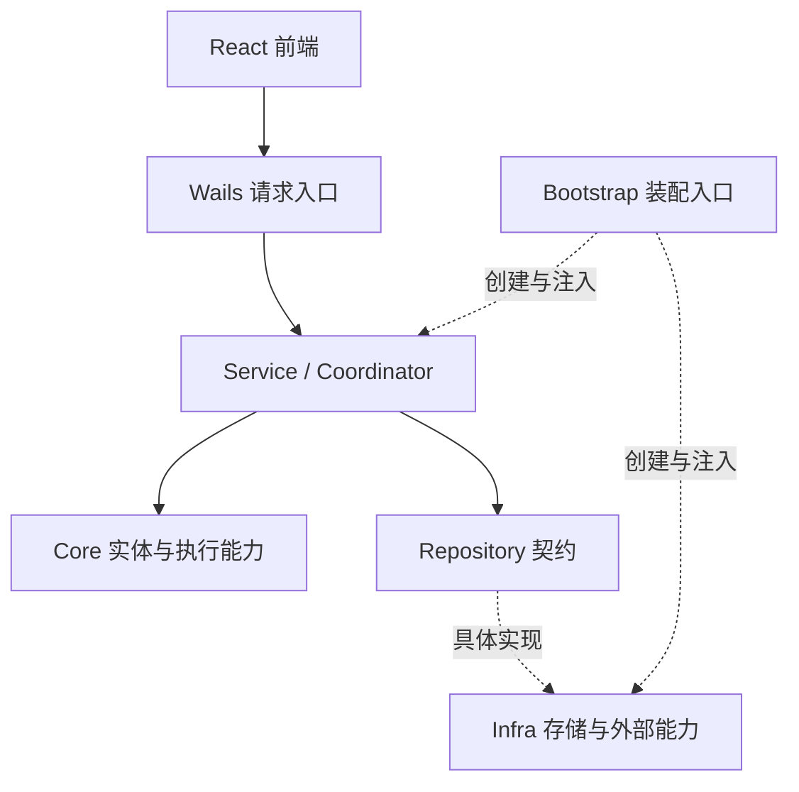
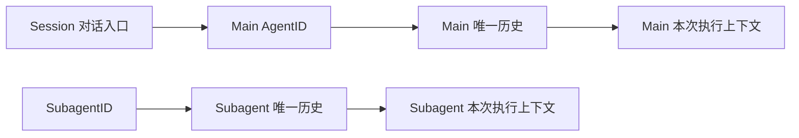

# Praxis 整体架构

## 架构概览

Praxis 是 Go + Wails + React 的本地桌面应用。前端负责交互与展示，Wails 连接桌面入口与后端业务；后端按照业务概念和能力划分模块，由 Bootstrap 统一装配，Service 与 Coordinator 编排业务流程，Core 提供实体和执行能力，Repository 定义持久化契约，Infra 提供具体实现。

## 目录与职责

路径以仓库根目录为起点。

| 目录 | 职责 |
| --- | --- |
| `frontend/src/app/` | 前端应用入口和页面组合 |
| `frontend/src/features/` | 工作区、项目、会话、Agent、计时和设置等业务功能 |
| `frontend/src/api/` | Wails 调用、传输类型和事件边界 |
| `frontend/src/components/` | 通用界面组件 |
| `frontend/src/styles/` | 全局样式和界面布局 |
| `backend/main.go` | 桌面进程入口 |
| `backend/wails/` | 桌面绑定、请求入口、DTO 和错误映射 |
| `backend/internal/bootstrap/` | 应用装配、依赖连接和生命周期管理 |
| `backend/internal/core/agent/` | Agent 内存实例、受锁保护的执行状态和角色定义 |
| `backend/internal/core/agent/execution/` | Execution 记录、本次执行实例 Run 与历史、配置、进度、结果和计时能力 |
| `backend/internal/core/session/` | 会话实体、模型选择和待办队列 |
| `backend/internal/core/session/entry/` | Agent 消息、内容块和执行归属的共享值类型 |
| `backend/internal/core/project/`、`core/workspace/` | 项目与工作区实体 |
| `backend/internal/core/context/` | 模型上下文构建和压缩 |
| `backend/internal/core/loop/` | 模型与工具的 ReAct 迭代 |
| `backend/internal/core/model/`、`core/provider/` | 模型配置和 Provider 调用契约 |
| `backend/internal/core/tool/`、`core/toolexecution/` | 工具契约、完整工具执行与授权流程、取消句柄和审批事实 |
| `backend/internal/core/security/` | 权限、审批和风险策略类型与规则 |
| `backend/internal/core/hook/` | 业务扩展和执行观察机制 |
| `backend/internal/repository/` | 统一持久化读写与查询契约 |
| `backend/internal/service/` | 各业务用例及跨模块协作 |
| `backend/internal/service/agent/execution/` | 执行准入、上下文准备、进度、结算和恢复 |
| `backend/internal/service/agent/` | Agent 实例查找、创建、状态查询和启动恢复 |
| `backend/internal/service/session/` | 会话用例、Main 历史追加与查询、Agent 实例引用持有、模型选择和输入队列 |
| `backend/internal/service/coordinator/` | Session FIFO 调度、暂停停止、ExecutionTools 绑定、审批唤醒和结算交接 |
| `backend/internal/service/toolexecution/` | 归属与规则读取、审核输入及预算准备、Main 工具回执接纳和中断回执构造 |
| `backend/internal/infra/storage/` | 完整内存记录、仓储查询和约束、有界后台保存队列及其生命周期 |
| `backend/internal/infra/jsonl/` | 启动日志重放、文件路径和顺序追加，不持有业务状态 |
| `backend/internal/infra/providers/` | 各模型 Provider 的协议实现 |
| `backend/internal/infra/modelregistry/`、`infra/agentregistry/`、`infra/toolregistry/` | 模型、Agent 和工具的配置加载与注册 |
| `backend/internal/infra/tools/`、`infra/filesystem/` | 具体工具和本地文件系统能力 |
| `backend/internal/identity/`、`clock/`、`errorcode/`、`fault/` | 身份、时间、稳定错误码和结构化错误等基础能力 |
| `backend/internal/settings/`、`dataroot/`、`logging/` | 应用配置、数据目录和日志 |

## 整体调用关系



Coordinator 在领取 Session 队首输入并取得 AgentExecution 的唯一运行权后，组织上下文、Loop 与本次 ExecutionTools。共享 Runner 执行一次逻辑上的 ReAct 过程，共享 ToolExecution Executor 负责单次工具调用的参数准备、授权、审核、等待、真实调用与回执提交。Core 通过注入的业务能力调用 Service，具体协议、文件系统与持久化实现由 Infra 提供。

审批等待期间 Execution 保持 running 并占用当前 Session，用户决定提交后只唤醒同一 Loop。后续 Task 保持排队，只有前一次 Execution 结算并释放归属，且结果允许继续派发，才领取下一项。ToolResult 是工具调用的唯一完成依据；审批请求、用户决定与审核状态只属于当前活跃调用，不做重启恢复。每次 ToolCall 开始授权时只读取一次内存规则，参数与规则决定在本次调用中固定，审批唤醒及工具启动不重新匹配规则；规则变更仅影响后续 ToolCall，每个调用最多产生一次人工审批请求。Coordinator 保证唯一 Loop，Loop 顺序执行各 ToolCall。回执由内存接纳后即可推进执行，不等待落盘；恢复只补缺失回执，不重新调用工具。Executor 的 active 索引用于当前调用的控制与审批查询，在本次 Execute 返回时移除。

## 模块依赖方向

- Core 定义业务概念与核心能力，不依赖 Service、Repository、Infra 或 Wails。
- Service 依赖 Core 与 Repository，负责业务流程；不直接依赖 Infra 的具体实现。
- Repository 使用 Core 类型定义持久化契约，不包含业务编排。
- Infra 实现 Repository 和外部能力契约，不依赖 Service。
- Wails 调用业务服务，负责桌面与业务之间的输入输出转换。
- Bootstrap 是统一装配入口，连接契约和具体实现。
- 前端通过 API 模块访问 Wails，业务功能由应用和工作区层组合。

Coordinator 与 Agent、Session 服务同级，负责跨模块执行编排；Agent 服务不依赖 Coordinator。暂停和停止直接接收 AgentID 与 ExecutionID，Coordinator 只控制当前身份匹配的 Execution，不匹配时正常跳过并返回 `Applied: false`，不保存控制命令。接受信号后取消执行 Context，并调用 Agent 自身的方法立即更新内存状态；当前执行身份保留到结算完成。原执行完成工具回执补齐和结果结算后才释放槽位，期间不能启动同一 Agent 的新执行；已接受控制的执行不自动领取后续输入，控制后新提交的输入或模型选择可以请求在收尾后重新调度。执行结果保存实际完成事实，结算后 Agent 以该结果更新状态，不以迟到信号覆盖完成事实。

Agent 详情由 Agent Service 返回 AgentView，从内存实例一致读取状态，再组合身份信息、当前 Execution 和最近一次 Execution，不复制带锁实例，也不在查询时叠加控制状态。Wails 直接返回查询结构，不复制 AgentSnapshot 或 ExecutionSnapshot；会话目录复用不含执行详情的 AgentView。前端沿用生成的查询类型，不扫描或排序执行历史列表来选择展示对象。

## 内存状态与本地保存

运行期间以 `infra/storage.Storage` 持有的完整内存记录为查询和约束检查的事实源。Bootstrap 创建存储时，只扫描一次项目日志和各会话日志，严格解码、归并最新记录；初始化完成后，普通仓储操作不再扫描文件。所有仓储共享内存锁，在同一受保护操作中校验引用、分配会话序号并接纳修改，磁盘操作不占用这把锁。

```text
启动：JSONL 全量重放 → 内存业务记录 → 实例及执行恢复 → 开放业务入口
运行：内存校验与接纳 → 立即继续业务
                      → 有界队列 → 唯一后台写入者 → JSONL
关闭：停止执行 → 停止接纳修改 → 尽力排空队列 → 关闭日志资源
```

后台队列最多保存 1024 项，按内存接纳顺序执行追加、会话文件创建和删除，不使用事务发布、失败回滚或逐条 fsync。队列满时业务不等待空位；首次文件操作失败后不自动重试结果不明的操作。两种情况都会记录持久化退化原因，`Storage.PersistenceError` 可读取该原因，关闭也会返回错误；内存业务继续运行，但本次进程不再接纳后续落盘操作，避免后续记录越过序号或依赖缺口。队列满前已经接纳的有序前缀仍尽力保存。关闭超时允许后续再次等待，不提前释放正在写入的资源。

内存接纳不等于磁盘保存。强制退出、断电、队列满和文件失败均可能丢失最新修改，包括删除操作；重启只恢复实际存在的完整日志行，不承诺恢复所有已执行的外部副作用。未完成尾行备份后截断，完整坏行报错。工具恢复只匹配已恢复的 Entry，补齐缺失结果，不恢复审批，也不自动重跑工具。显式日志路径查询允许访问文件系统，文件可能落后于内存，新会话尚未保存时可以返回不存在。

记录格式保持单 Event。发布与回滚保留匹配的程序和数据备份；人工验证使用独立数据目录，检查重启恢复、内存查询不依赖日志文件、持久化退化后业务可用以及关闭排空。常规验证仅运行构建和静态检查，不启动开发服务或执行自动化测试。

## Agent 角色定义

Agent 通过 `config/agents/<definition_id>/ROLE.md` 定义角色。目录名是稳定的定义 ID，用于持久化引用；`name` 只是展示属性，角色类型与身份、职责和提示词由文件内容声明。多个不同定义可以使用相同角色类型，名称不参与权限或消息流选择。

```markdown
---
name: 代码审查助手
role: advisor
---

# 角色身份

你是代码审查顾问，负责分析实现、识别风险，并给出可验证的修改建议。

## 工作要求

先检查相关代码和约束，区分已确认的问题与待验证的假设。
```

文件头使用 YAML，且只允许 `name` 和 `role` 两个字段：

| 字段 | 含义与约束 |
| --- | --- |
| `name` | 必填展示名称，不允许首尾空白或控制字符；不要求与目录名一致 |
| `role` | 必填角色类型，取值为 `primary`、`delegate`、`advisor`、`curator` |
| Markdown 正文 | 必填角色身份、职责和系统提示词；正文外围空行不进入提示词 |

`agentregistry` 在配置输入边界解析 UTF-8 文件，支持 LF 和 CRLF 换行，拒绝未知或重复的元数据字段、非法角色、空名称和空正文。YAML 文件头不进入模型上下文，Markdown 正文作为 `AgentDefinition.Instructions`，执行准入时冻结到 `ExecutionConfig.SystemPrompt`。

`AgentDefinition` 保存稳定 ID、展示名称、Role 和指令；Session 内的 Agent 实例只引用定义 ID，并持有实例类型 `Kind`，不复制定义中的 Role。`Kind` 由创建实例的业务流程明确指定，取值为 `main` 或 `subagent`，不从目录名、名称或 Role 推导。同一份角色定义可以用于不同类型的实例；`primary` 是默认定义 ID，不限制其他定义被用作 Main。

消息历史通过 AgentID 隔离。Session Service 统一提供会话独立输入追加与历史查询，按 Session.MainAgentID 访问 Main 的唯一历史；Agent Service 不承担消息读写。面向 AgentID 的消息查询由 Coordinator 分派：Main 委托 Session Service，Subagent 读取当前 Run 的私有消息。执行中的输入、输出和工具回执仍由执行用例按 Execution 归属提交。Main 的跨执行历史保留在共享内存仓储中，并尽力保存到 JSONL；Subagent 只持有本次 Run 的隔离历史。Session 对话直接使用 Main 的消息和当前执行上下文，不建立独立 Session 消息流或另一份长期模型上下文。需要保留的约束、决定和参考信息作为同一历史中的条目追加；必要时使用 `ContextEntry.Protected` 保留模型构建与压缩时必须保留的内容。

Subagent 的消息按自身 AgentID 隔离，不自动读取 Main 或其他 Subagent 的历史，需要的信息由委派输入明确提供。模型构建统一读取本次执行所属 Agent 的有效历史，不按 Main/Subagent 分别拼接额外的 Session 上下文。Session 内最多存在一个 Main，由 Session 的 MainAgentID 明确引用，不通过定义 ID 查找主实例；实例类型创建后不可改变。

Agent 对象和运行状态不持久化。Session 只保存主 Agent 的 MainAgentID 与 AgentDefinitionID，Main Execution 和消息保存各自的归属事实。Agent 服务负责主实例的查找、创建及启动恢复，Session 服务按会话持有同一批实例引用并在会话删除时释放；身份字段创建后不变，状态变更由 Agent 自身的锁保护。启动时先全量重建存储内存状态，再按 Session 重建主实例并根据当前或最近 Execution 初始化状态；Coordinator 随后补齐中断回执并恢复活动 Main Execution。Subagent、尚未开始的输入、审批等待和进程内控制意图不参与恢复。

消息仓储显式接收 SessionID、AgentID 与消息，SessionID 决定日志文件，AgentID 决定消息历史。仓储根据 Session.MainAgentID 只接纳 Main 的消息、执行、计时和用量，校验 Session、Execution 与消息之间的归属一致性，不依赖 Agent 对象。ToolCall 与 ToolResult 从内存 Entry 派生匹配，不建立独立工具调用实体或持久化状态；查询返回独立副本，不能修改仓储持有的正文。

一次执行从本次 Run 的有效历史构建一份可变 `ModelContext`，通过指针交给 Loop。Main 的模型输出与工具回执先由共享内存仓储接纳，再合入 Run 和本次上下文；Subagent 直接接纳到本次历史。两者都不以落盘成功为推进条件。存储层不保存模型上下文，Run 和上下文在执行结束后释放；Main 重启时按实际落盘历史重建，压缩摘要也来自同一历史。



配置重载允许修改名称、Role 和指令，不允许删除已加载定义。展示名称在后续查询中生效，指令在后续执行准入时生效，已经开始的执行沿用冻结的提示词；角色属性变化不改变实例类型或上下文边界。候选定义校验全部成功后整体发布，失败时继续使用当前定义；需要回退角色属性或指令时，恢复相应 `ROLE.md` 内容并重新加载。

初始化为四种内置角色补齐缺失的 `ROLE.md`，不覆盖已有文件。配置及持久化恢复按当前结构严格校验，不提供迁移或兼容读取。验证使用后端构建、`go vet`、直接 import 分层检查、Wails 绑定生成和前端 `npm run check`；人工回归核对自定义名称、Session 与 Main 查询结果一致、Subagent 历史隔离、Main 唯一性、消息幂等与回执配对、会话删除释放历史、重启后的摘要恢复、非法文件头与执行提示词冻结。
