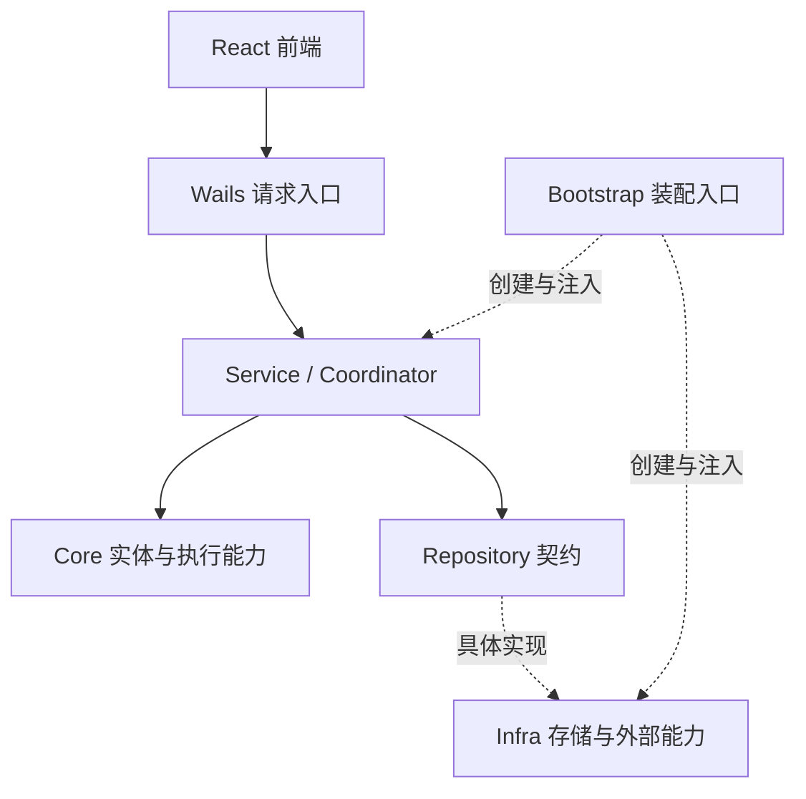

# Praxis 整体架构

## 架构概览

Praxis 是 Go + Wails + React 的本地桌面应用。前端负责交互与展示，Wails 连接桌面入口与后端业务；后端按照业务概念和能力划分模块，由 Bootstrap 统一装配，Service 与 Coordinator 编排业务流程，Core 提供实体和执行能力，Repository 定义持久化契约，Infra 提供具体实现。

## 目录与职责

路径以仓库根目录为起点。

| 目录 | 职责 |
| --- | --- |
| `frontend/src/app/` | 前端应用入口和页面组合 |
| `frontend/src/features/` | 工作区、项目、会话、Agent、计时和设置等业务功能 |
| `frontend/src/api/` | Wails 调用、传输类型和事件边界 |
| `frontend/src/components/` | 通用界面组件 |
| `frontend/src/styles/` | 全局样式和界面布局 |
| `backend/main.go` | 桌面进程入口 |
| `backend/wails/` | 桌面绑定、请求入口、DTO 和错误映射 |
| `backend/internal/bootstrap/` | 应用装配、依赖连接和生命周期管理 |
| `backend/internal/core/agent/` | Agent 实体、定义、配置和控制意图 |
| `backend/internal/core/agent/execution/` | Execution 实体、配置、进度、结果和执行计时能力 |
| `backend/internal/core/session/` | 会话实体、历史、模型选择、待办队列和执行占用 |
| `backend/internal/core/session/entry/` | 历史条目、内容块和消息归属 |
| `backend/internal/core/project/`、`core/workspace/` | 项目与工作区实体 |
| `backend/internal/core/context/` | 模型上下文构建和压缩 |
| `backend/internal/core/loop/` | 模型与工具的 ReAct 迭代 |
| `backend/internal/core/model/`、`core/provider/` | 模型配置和 Provider 调用契约 |
| `backend/internal/core/tool/`、`core/toolexecution/` | 工具契约、完整工具执行与授权流程、取消句柄和审批事实 |
| `backend/internal/core/security/` | 权限、审批和风险策略类型与规则 |
| `backend/internal/core/hook/` | 业务扩展和执行观察机制 |
| `backend/internal/repository/` | 统一持久化读写与查询契约 |
| `backend/internal/service/` | 各业务用例及跨模块协作 |
| `backend/internal/service/agent/execution/` | 执行准入、上下文准备、进度、结算和恢复 |
| `backend/internal/service/agent/coordinator/` | Session FIFO 调度、ExecutionTools 绑定、审批唤醒和结算交接 |
| `backend/internal/service/toolexecution/` | 归属与规则读取、审核输入及预算准备、审批事实和工具回执持久化 |
| `backend/internal/infra/storage/`、`infra/jsonl/` | 仓储实现、查询索引和 JSONL 日志存储 |
| `backend/internal/infra/providers/` | 各模型 Provider 的协议实现 |
| `backend/internal/infra/modelregistry/`、`infra/agentregistry/`、`infra/toolregistry/` | 模型、Agent 和工具的配置加载与注册 |
| `backend/internal/infra/tools/`、`infra/filesystem/` | 具体工具和本地文件系统能力 |
| `backend/internal/identity/`、`clock/`、`errorcode/`、`fault/` | 身份、时间、稳定错误码和结构化错误等基础能力 |
| `backend/internal/settings/`、`dataroot/`、`logging/` | 应用配置、数据目录和日志 |

## 整体调用关系

Coordinator 在领取 Session 队首输入并取得 AgentExecution 的唯一运行权后，组织上下文、Loop 与本次 ExecutionTools。共享 Runner 执行一次逻辑上的 ReAct 过程，共享 ToolExecution Executor 负责单次工具调用的参数准备、授权、审核、等待、真实调用与回执提交。Core 通过注入的业务能力调用 Service，具体协议、文件系统与持久化实现由 Infra 提供。

审批等待期间 Execution 保持 running 并占用当前 Session，用户决定提交后只唤醒同一 Loop。后续 Task 保持排队，只有前一次 Execution 结算并释放归属，且结果允许继续派发，才领取下一项。ToolResult 是工具调用的唯一完成依据；审批请求、用户决定与 Review 分别保存可靠事实。每次 ToolCall 开始授权时只读取一次内存规则，参数与规则决定在本次调用中固定，审批唤醒及工具启动不重新匹配规则；规则变更仅影响后续 ToolCall，每个调用最多产生一次人工审批请求。Coordinator 保证唯一 Loop，Loop 顺序执行各 ToolCall；工具回执写入失败后退出 Loop，恢复只补缺失回执，不重新调用工具。Executor 的 active 索引仅用于 Stop 定位取消句柄，在本次 Execute 返回时移除。

## 模块依赖方向

- Core 定义业务概念与核心能力，不依赖 Service、Repository、Infra 或 Wails。
- Service 依赖 Core 与 Repository，负责业务流程；不直接依赖 Infra 的具体实现。
- Repository 使用 Core 类型定义持久化契约，不包含业务编排。
- Infra 实现 Repository 和外部能力契约，不依赖 Service。
- Wails 调用业务服务，负责桌面与业务之间的输入输出转换。
- Bootstrap 是统一装配入口，连接契约和具体实现。
- 前端通过 API 模块访问 Wails，业务功能由应用和工作区层组合。

Agent 详情由 Agent Service 返回 AgentView，直接组合 Core Agent、当前 Execution 和最近一次 Execution。Wails 直接返回查询结构，不复制 AgentSnapshot 或 ExecutionSnapshot；会话目录复用不含执行详情的 AgentView。前端沿用生成的查询类型，不扫描或排序执行历史列表来选择展示对象。
