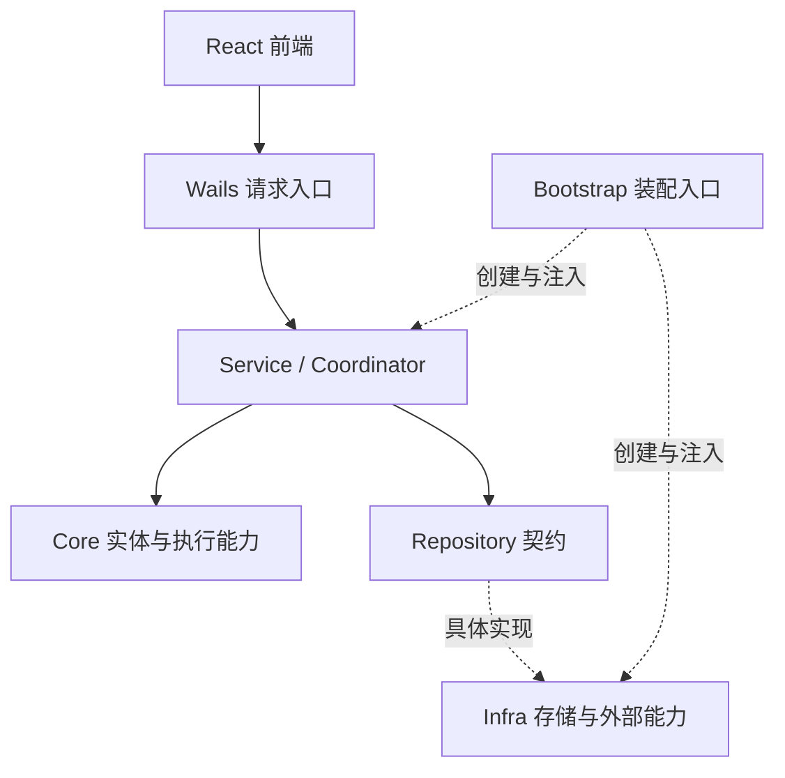
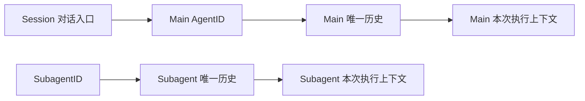

# Praxis 整体架构

## 架构概览

Praxis 是 Go + Wails + React 的本地桌面应用。前端负责交互与展示，Wails 连接桌面入口与后端业务；后端按照业务概念和能力划分模块，由 Bootstrap 统一装配，Service 与 Coordinator 编排业务流程，Core 提供实体和执行能力，Repository 定义持久化契约，Infra 提供具体实现。

## 目录与职责

路径以仓库根目录为起点。

| 目录 | 职责 |
| --- | --- |
| `frontend/src/app/` | 前端应用入口和页面组合 |
| `frontend/src/features/` | 工作区、项目、会话、Agent、计时和设置等业务功能 |
| `frontend/src/api/` | Wails 调用、传输类型和事件边界 |
| `frontend/src/components/` | 通用界面组件 |
| `frontend/src/styles/` | 全局样式和界面布局 |
| `backend/main.go` | 桌面进程入口 |
| `backend/wails/` | 桌面绑定、请求入口、DTO 和错误映射 |
| `backend/internal/bootstrap/` | 应用装配、依赖连接和生命周期管理 |
| `backend/internal/core/agent/` | Agent 实体、角色类型、定义、唯一消息历史和控制意图 |
| `backend/internal/core/agent/execution/` | Execution 实体、配置、进度、结果和执行计时能力 |
| `backend/internal/core/session/` | 会话实体、模型选择、待办队列和执行占用 |
| `backend/internal/core/session/entry/` | Agent 消息、内容块和执行归属的共享值类型 |
| `backend/internal/core/project/`、`core/workspace/` | 项目与工作区实体 |
| `backend/internal/core/context/` | 模型上下文构建和压缩 |
| `backend/internal/core/loop/` | 模型与工具的 ReAct 迭代 |
| `backend/internal/core/model/`、`core/provider/` | 模型配置和 Provider 调用契约 |
| `backend/internal/core/tool/`、`core/toolexecution/` | 工具契约、完整工具执行与授权流程、取消句柄和审批事实 |
| `backend/internal/core/security/` | 权限、审批和风险策略类型与规则 |
| `backend/internal/core/hook/` | 业务扩展和执行观察机制 |
| `backend/internal/repository/` | 统一持久化读写与查询契约 |
| `backend/internal/service/` | 各业务用例及跨模块协作 |
| `backend/internal/service/agent/execution/` | 执行准入、上下文准备、进度、结算和恢复 |
| `backend/internal/service/agent/coordinator/` | Session FIFO 调度、ExecutionTools 绑定、审批唤醒和结算交接 |
| `backend/internal/service/toolexecution/` | 归属与规则读取、审核输入及预算准备、审批事实和工具回执持久化 |
| `backend/internal/infra/storage/`、`infra/jsonl/` | 仓储实现、查询索引和 JSONL 日志存储 |
| `backend/internal/infra/providers/` | 各模型 Provider 的协议实现 |
| `backend/internal/infra/modelregistry/`、`infra/agentregistry/`、`infra/toolregistry/` | 模型、Agent 和工具的配置加载与注册 |
| `backend/internal/infra/tools/`、`infra/filesystem/` | 具体工具和本地文件系统能力 |
| `backend/internal/identity/`、`clock/`、`errorcode/`、`fault/` | 身份、时间、稳定错误码和结构化错误等基础能力 |
| `backend/internal/settings/`、`dataroot/`、`logging/` | 应用配置、数据目录和日志 |

## 整体调用关系



Coordinator 在领取 Session 队首输入并取得 AgentExecution 的唯一运行权后，组织上下文、Loop 与本次 ExecutionTools。共享 Runner 执行一次逻辑上的 ReAct 过程，共享 ToolExecution Executor 负责单次工具调用的参数准备、授权、审核、等待、真实调用与回执提交。Core 通过注入的业务能力调用 Service，具体协议、文件系统与持久化实现由 Infra 提供。

审批等待期间 Execution 保持 running 并占用当前 Session，用户决定提交后只唤醒同一 Loop。后续 Task 保持排队，只有前一次 Execution 结算并释放归属，且结果允许继续派发，才领取下一项。ToolResult 是工具调用的唯一完成依据；审批请求、用户决定与 Review 分别保存可靠事实。每次 ToolCall 开始授权时只读取一次内存规则，参数与规则决定在本次调用中固定，审批唤醒及工具启动不重新匹配规则；规则变更仅影响后续 ToolCall，每个调用最多产生一次人工审批请求。Coordinator 保证唯一 Loop，Loop 顺序执行各 ToolCall；工具回执写入失败后退出 Loop，恢复只补缺失回执，不重新调用工具。Executor 的 active 索引仅用于 Stop 定位取消句柄，在本次 Execute 返回时移除。

## 模块依赖方向

- Core 定义业务概念与核心能力，不依赖 Service、Repository、Infra 或 Wails。
- Service 依赖 Core 与 Repository，负责业务流程；不直接依赖 Infra 的具体实现。
- Repository 使用 Core 类型定义持久化契约，不包含业务编排。
- Infra 实现 Repository 和外部能力契约，不依赖 Service。
- Wails 调用业务服务，负责桌面与业务之间的输入输出转换。
- Bootstrap 是统一装配入口，连接契约和具体实现。
- 前端通过 API 模块访问 Wails，业务功能由应用和工作区层组合。

Agent 详情由 Agent Service 返回 AgentView，直接组合 Core Agent、当前 Execution 和最近一次 Execution。Wails 直接返回查询结构，不复制 AgentSnapshot 或 ExecutionSnapshot；会话目录复用不含执行详情的 AgentView。前端沿用生成的查询类型，不扫描或排序执行历史列表来选择展示对象。

## Agent 角色定义

Agent 通过 `config/agents/<definition_id>/ROLE.md` 定义角色。目录名是稳定的定义 ID，用于持久化引用；`name` 只是展示属性，角色类型与身份、职责和提示词由文件内容声明。多个不同定义可以使用相同角色类型，名称不参与权限或消息流选择。

```markdown
---
name: 代码审查助手
role: advisor
---

# 角色身份

你是代码审查顾问，负责分析实现、识别风险，并给出可验证的修改建议。

## 工作要求

先检查相关代码和约束，区分已确认的问题与待验证的假设。
```

文件头使用 YAML，且只允许 `name` 和 `role` 两个字段：

| 字段 | 含义与约束 |
| --- | --- |
| `name` | 必填展示名称，不允许首尾空白或控制字符；不要求与目录名一致 |
| `role` | 必填角色类型，取值为 `primary`、`delegate`、`advisor`、`curator` |
| Markdown 正文 | 必填角色身份、职责和系统提示词；正文外围空行不进入提示词 |

`agentregistry` 在配置输入边界解析 UTF-8 文件，支持 LF 和 CRLF 换行，拒绝未知或重复的元数据字段、非法角色、空名称和空正文。YAML 文件头不进入模型上下文，Markdown 正文作为 `AgentDefinition.Instructions`，执行准入时冻结到 `ExecutionConfig.SystemPrompt`。

`AgentDefinition` 保存稳定 ID、展示名称、Role 和指令；Session 内的 Agent 实例只引用定义 ID，并保存实例类型 `Kind`，不复制定义中的 Role。`Kind` 由创建实例的业务流程明确指定，取值为 `main` 或 `subagent`，不从目录名、名称或 Role 推导。同一份角色定义可以用于不同类型的实例；`primary` 是默认定义 ID，不限制其他定义被用作 Main。

每个 Agent 都通过 AgentID 拥有唯一的消息历史，Main 与 Subagent 使用相同的读写规则。Session 的历史与上下文就是其 Main Agent 的历史与上下文：会话入口先找到 Main，再直接读取或追加该 Agent 的消息，不建立独立 Session 消息流、共享事实集合或模型上下文副本。需要长期保留的约束、决定和参考信息作为同一历史中的条目追加；必要时使用 `ContextEntry.Protected` 保留模型构建与压缩时必须保留的内容。

Subagent 的消息按自身 AgentID 隔离，不自动读取 Main 或其他 Subagent 的历史，需要的信息由委派输入明确提供。模型构建统一读取本次执行所属 Agent 的有效历史，不按 Main/Subagent 分别拼接额外的 Session 上下文。Session 内最多存在一个 Main，仓储按实例类型建立查询索引和唯一约束，不通过定义 ID 查找主实例；实例类型创建后不可改变。

消息仓储只接收 AgentID 与消息，不接收可独立指定的流归属或 SessionID；日志文件所属 Session 从 Agent 的持久化归属确定。消息存储不判断 Main/Subagent 类型。每个 Agent 的只读历史正文只保存一份，消息索引共享该正文；Session 全量消息索引仅服务消息存在性等聚合查询，不用于拼接 Main 上下文。

一次执行从所属 Agent 的有效历史构建一份可变 `ModelContext`，通过指针交给 Loop，模型输出与工具回执持久化到同一 Agent 历史后追加到本次上下文。存储层和 History 不保存执行上下文，执行结束后释放；恢复时按同一 Agent 历史重建，压缩摘要也保存在该历史中。这样 Session 不持有另一份 Context，也不会把一次执行的模型上下文保留到进程结束。



配置重载允许修改名称、Role 和指令，不允许删除已加载定义。展示名称在后续查询中生效，指令在后续执行准入时生效，已经开始的执行沿用冻结的提示词；角色属性变化不改变实例类型或上下文边界。候选定义校验全部成功后整体发布，失败时继续使用当前定义；需要回退角色属性或指令时，恢复相应 `ROLE.md` 内容并重新加载。

初始化为四种内置角色补齐缺失的 `ROLE.md`，不覆盖已有文件。配置及持久化恢复按当前结构严格校验，不提供迁移或兼容读取。验证使用后端构建、`go vet`、直接 import 分层检查、Wails 绑定生成和前端 `npm run check`；人工回归核对自定义名称、Session 与 Main 查询结果一致、Subagent 历史隔离、Main 唯一性、消息幂等与回执配对、会话删除释放历史、重启后的摘要恢复、非法文件头与执行提示词冻结。
