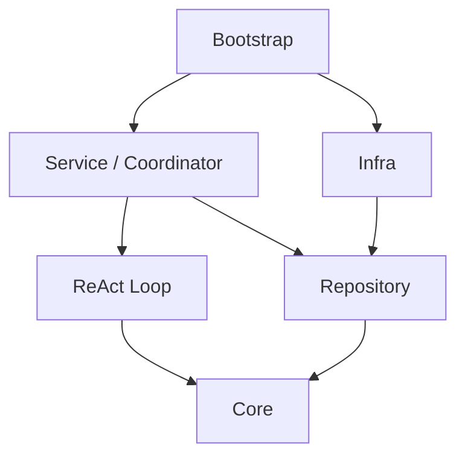

# Praxis 后端架构

## 架构目标

Praxis 是 Go + Wails + React 的本地桌面应用。后端按业务实体和明确能力划分职责：纯模型与状态转换放在 Core，持久化契约统一由 Repository 定义，业务用例由 Service 编排，外部协议与本地持久化由 Infra 实现，进程装配统一由 Bootstrap 完成。

两个业务模块需要协作时，由拥有完整用例的上层模块负责编排；仅需要对方局部业务能力时，由消费方定义窄接口并在 Bootstrap 注入。持久化接口统一放在 Repository，消费方直接引用，不自行声明同类读写接口。跨包类型由事实拥有者定义，不为消除 import 而建立同形副本或无价值的中间层。

## 当前模块与目录

以下目录对应当前实现，路径均以仓库根目录为起点。

| 目录 | 职责 |
| --- | --- |
| `frontend/src/` | React 页面、业务组件、前端状态、Wails 调用边界和样式 |
| `backend/main.go` | 桌面进程入口，解析数据目录、启动 Wails 并嵌入前端产物 |
| `backend/wails/` | Wails 绑定、请求校验、DTO、事件和错误映射 |
| `backend/internal/bootstrap/` | 唯一进程装配入口；配置加载、依赖连接、启动恢复、资源关闭 |
| `backend/internal/core/context/` | Provider 无关的上下文内容、容量检查及压缩策略 |
| `backend/internal/loop/` | ReAct Loop，决定模型迭代、工具调用和模型流处理；不管理 Execution 终态 |
| `backend/internal/core/model/` | 模型配置、请求与流、停止原因、Usage 和工具调用 ID 契约 |
| `backend/internal/core/message/` | 消息实体、内容块、逻辑 StreamKey 和 Record；调用从已提交消息派生 |
| `backend/internal/core/tool/` | 工具请求、执行参数、结果、注册表、目录及参数规范化契约 |
| `backend/internal/core/toolexecution/` | 工具控制事件、审批事实及可取消的运行实例 |
| `backend/internal/core/task/` | 预约 Task 的状态和转换（`pending/dispatched/cancelled`） |
| `backend/internal/core/hook/` | 操作 Hook 与业务提交后通知的分发机制 |
| `backend/internal/core/agent/`、`session/`、`project/`、`workspace/`、`timing/` | 业务实体、值类型、不变量和纯状态规则 |
| `backend/internal/repository/` | 所有业务仓储、统一 Message 存取、ToolCall 派生查询、用量与计时持久化及事务契约 |
| `backend/internal/service/agent/` | Agent 查询、控制、私有消息入口和消息流选择规则 |
| `backend/internal/service/agent/execution/` | 直接输入准入、配置及历史冻结、Assistant 与 Execution 原子提交、进度、结算和恢复 |
| `backend/internal/service/agent/coordinator/` | 进程内 Coordinator、ActiveTasks、运行交接、审批唤醒、启动恢复及关闭 |
| `backend/internal/service/task/` | 预约输入与 FIFO 队列的提交、查询及取消；不执行模型 |
| `backend/internal/service/toolexecution/` | 工具准入、参数授权、风险审核、审批和执行结算 |
| `backend/internal/service/project/`、`session/`、`model/` | 项目、会话与模型配置等业务用例 |
| `backend/internal/infra/storage/` | 事务、完整内存 State、通用 groups/unique 索引和 Repository 实现 |
| `backend/internal/infra/jsonl/` | JSONL codec、append/fsync、启动 Replay、尾行恢复、文件锁与文件寻址 |
| `backend/internal/infra/providers/` | OpenAI Chat、OpenAI Responses、Anthropic 的独立协议 Encoder/Decoder 与流处理 |
| `backend/internal/infra/modelregistry/`、`agentregistry/`、`toolregistry/` | 模型、Agent 和工具配置的加载与注册 |
| `backend/internal/infra/tools/`、`filesystem/` | Bash、ReadFile、ApplyPatch 与受限文件系统访问的具体实现 |
| `backend/internal/identity/`、`clock/`、`fault/`、`security/` | 共享身份、时间、错误和授权策略 |
| `backend/internal/settings/`、`dataroot/`、`logging/`、`timing/` | 全局配置、数据目录、日志与执行耗时 |

协议行为与 Schema 的约束独立记录在 [模型协议契约](../docs/protocols/providers.md)；架构文档只说明协议实现的归属及依赖边界。

## 调用与依赖方向

以下箭头表示编译期依赖；具体实现由 Bootstrap 创建并注入。



前端通过 Wails 调用业务 Service 和 Coordinator；Coordinator 调用 Execution Service、Task Service 及 Loop。Loop 通过注入的模型和工具执行能力发起外部调用。

- `core` 不依赖 `repository`、`loop`、`service`、`infra`、`bootstrap` 或 Wails，也不执行文件 I/O。
- `service` 编排用例和事务，通过 Repository 契约使用仓储；不直接调用 Infra 的文件系统和 JSONL 实现。
- `repository` 只依赖 Core 实体与纯基础能力，统一定义持久化契约；Storage 通过编译期断言检查实现。
- `infra` 实现协议、存储、配置和工具，不依赖 Service，不负责审批、队列派发或运行期业务决策。
- `loop` 位于 Core 外，通过 Execution Service 注入的 AssistantCommitter 原子提交输出，再将已提交的完整 ToolCall 传给 ToolExecution Service；迭代预留、状态检查和进度事务由 Execution Service 提供。
- `coordinator` 负责进程内执行权和运行交接；`loop` 只负责一次执行内部的模型与工具迭代。
- `bootstrap` 构建并注入依赖，完成恢复后才对 Wails 开放业务入口；不在运行期重新解释业务决策。
- 业务能力接口放在事实拥有者或消费方附近，避免为依赖注入再建不必要的转发服务。

## AgentExecution、预约 Task 与执行流程

**AgentExecution 是一次真实运行的唯一身份。** 直接输入不会创建预约 Task；预约 Task 只保存待执行输入，领取时才创建 AgentExecution，并通过 `SourceTaskID` 保留来源。模型请求、消息、工具执行、审批、用量、计时和控制均关联具体的 Execution。

**直接输入：**

1. 请求边界完成输入规范化和必要校验。
2. Execution Service 在同一事务中检查幂等请求与 Agent 归属，保存用户消息、冻结执行配置与历史可见性，并创建 AgentExecution。
3. Coordinator 取得 ActiveTasks 执行权，读取冻结上下文，交由 ReAct Loop 运行。
4. Loop 保存模型输出并执行工具；Execution Service 负责进度记录和持久化结算。只有结算提交并释放执行权后，才可能领取下一预约。

**预约输入：**

1. Task Service 幂等保存预约及输入消息，按持久化序号维护 FIFO。
2. Coordinator 在 Agent 可运行时调用 Execution Service 领取队首；领取事务冻结配置与上下文、创建 Execution、将 Task 标记为 `dispatched`。
3. 预约可以在 `pending` 时取消；预约不承担执行结果的终态语义。
4. 后续运行与结算复用直接输入的 Execution 流程。

模型响应终止原因、Loop 返回原因和业务 Execution 结算结果是不同层次，分别由 `model.ModelStopReason`、`loop.EndReason` 和 `agent.ExecutionOutcome` 表达，不互相混用。

## 上下文、模型与工具

- Execution Service 在准入或领取事务中冻结执行配置、消息序号边界、需要排除的未派发输入以及共享上下文引用。队列中后到的输入不能进入已经开始的 Execution。
- 恢复上下文时，业务层加载冻结范围内的历史、当前输入与本次 Execution 的续接消息；工具请求和回执按 `(ExecutionID, CallID)` 配对，并转换为有序的 `context.Content`。
- `ContextBuilder` 只接收通用 Content 和 Limits，不理解 Session、Task 或 Repository；它负责复制、处理模型可见内容并检查必要原文容量。历史压缩由 Core 压缩策略执行。
- ModelBuilder 根据冻结的模型配置提供 Provider 请求流；各 Provider 独立编码请求、解析响应和停止信号，不承担历史选择或 Execution 生命周期。
- `model.ToolCall` 是 Provider 返回的纯工具请求；`message.ToolCall` 是从已提交 Assistant 派生的完整调用及执行归属。`toolexecution.Execution` 只管理正在运行的工具实例，控制事件与结果分别由 ToolExecution Repository 和 Message 保存。调用唯一性为 `(ExecutionID, ProviderToolCallID)`。
- ToolExecution Service 调用工具前执行准入、规范化结果检查、命令策略和风险审核；需要审批时保留原 Execution，批准后唤醒同一执行，不重复创建新执行。

## 持久化、恢复与通知

- 应用使用共享的 Storage Store，底层持久化由 JSONL Log 提供。项目索引与应用状态放在数据根目录的 `state/`，会话日志位于 `projects/<projectID>/sessions/<sessionID>.jsonl`，配置位于 `config/`。
- 一行日志对应一次原子提交。启动完整 Replay 建立 Memory State；entries 保存独立 json.RawMessage，groups 保存集合索引，unique 保存唯一索引。普通 Repository 查询只解码内存 payload，返回独立对象。
- 写入先暂存并校验 overlay，再 append + fsync，成功后在事务锁内原子发布 State。文件长度、路径和游标仅由 JSONL Log 管理。
- StreamKey 只表示逻辑分组。Session Service 管理共享消息，Agent Service 管理私有消息，Execution Service 使用不可变 Agent 身份确定并冻结输出流；Storage 只接收显式流键。
- Task 的队列序号与 Event 的日志序号分开。NextSequence 从该 Agent 保留的全部 Task 及事务暂存变更计算；取消或派发不回收序号。
- Execution Service 在同一事务保存 Assistant、工具调用计数和最终输出证据；ToolExecution Service 在同一事务保存 ToolResult 和累计输出字节，幂等重试不重复累计。
- ToolCall 与 ToolResult 的唯一索引指向所属 Message，缺失回执由工具消息分组与结果索引派生；审批、Stop 和恢复只查询内存。正常 Execute/Resume 直接使用同一 Loop 的完整 ToolCall，审批续接使用已审核参数快照。
- Session 的存在性和可写性在 Service 的写入事务内校验，删除同时检查活动 Execution。删除事件清空 Scope 的实体与全部索引；Session 身份不复用，Replay 拒绝终止事件之后的业务事件。
- ToolResult 缺失与遗留运行工具的恢复决策属于业务层。已开始且副作用未知的工具不能自动重试。
- 启动时先协调遗留 running 工具，再恢复活动 Execution，最后检查空闲 Agent 的 Pending 队列。审批等待不释放执行归属。
- 结算失败时保留执行占用和结果，只重试结算，不重新调用模型或工具。关闭时先停止新准入并等待运行退出，再清理和关闭持久化资源。
- 所有实体存取、工具查询、计时、用量和跨仓储事务接口统一在 Repository。Loop 的 AssistantCommitter 是绑定执行的跨实体业务用例接口。
- Store 与 Repository 不发布业务 Hook。用户输入、最终 Assistant 和 Execution 终态由业务调用方在事务成功后发布 best-effort 提交 Hook；回滚和幂等重复不通知。
- Operation Hook 在真实运行边界记录模型、工具与 Agent 操作的耗时；事件发布用于 UI 实时展示，不作为持久化恢复事实来源。
- 配置更新通过共享配置锁和存储事务协调，避免执行准入读取混合配置；持久化恢复只校验当前 Schema，不自动迁移或修补原始数据。

## 错误归属与文件组织

领域状态错误归 Core，业务用例错误归 Service，技术读写错误归 Infra。每个 Go 包默认使用一个 `errors.go`，集中放置错误定义、分类及简单转换，不创建空错误文件。Execution 的持久化失败码属于领域值类型，位于 `core/agent/execution_failure.go`；Provider 失败详情转换位于 `service/agent/errors.go`。Agent 显示名称由 Wails 投影。

## 输入与桌面边界

- Wails 负责请求形状、字段输入边界、DTO 转换和错误映射，不读取底层存储或构造 Provider。
- 一份输入由实际入口完成规范化、默认值和校验；下游只消费 canonical 值，不反复 Trim、Clean 或重新解析。磁盘恢复是独立的不可信输入边界，只读校验，不静默写回修复。
- 文件预览由 Session 业务确认工作区与访问授权，再由 Infra Filesystem 执行受限读取。
- 前端经 `frontend/src/api/` 消费 Wails Binding 与事件；React 页面及状态处理不直接依赖持久化格式。

## 验证

后端使用格式检查、编译、静态分析和包依赖门禁：

```bash
cd backend
gofmt -l .
go build ./...
go vet ./...
bash scripts/check-dependencies.sh
```

Wails Binding 签名发生变化时，重新生成绑定并检查前端：

```bash
cd backend
go run -tags bindings .
cd ../frontend
npm run check
```

运行期正确性通过独立临时数据验证直接输入、预约 FIFO、幂等、审批与拒绝、Pause/Stop 竞争、启动恢复、未知副作用、结算失败、配置重载和关闭行为。验证不自动启动开发服务。
