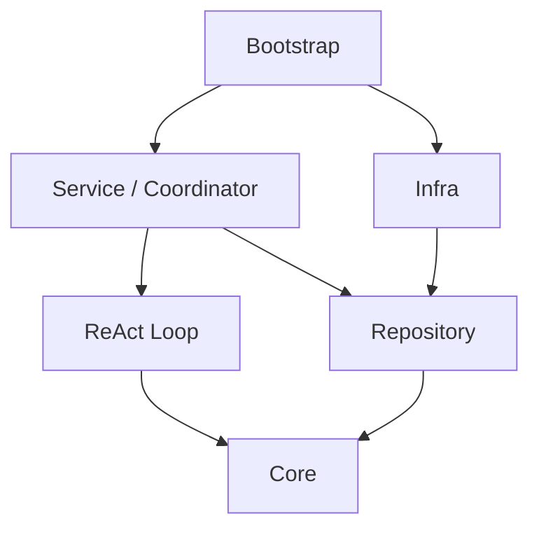

# Praxis 后端架构

## 架构目标

Praxis 是 Go + Wails + React 的本地桌面应用。后端按业务实体和明确能力划分职责：纯模型与状态转换放在 Core，持久化契约统一由 Repository 定义，业务用例由 Service 编排，外部协议与本地持久化由 Infra 实现，进程装配统一由 Bootstrap 完成。

两个业务模块需要协作时，由拥有完整用例的上层模块负责编排；仅需要对方局部业务能力时，由消费方定义窄接口并在 Bootstrap 注入。持久化接口统一放在 Repository，消费方直接引用，不自行声明同类读写接口。跨包类型由事实拥有者定义，不为消除 import 而建立同形副本或无价值的中间层。

## 当前模块与目录

以下目录对应当前实现，路径均以仓库根目录为起点。

| 目录 | 职责 |
| --- | --- |
| `frontend/src/` | React 页面、业务组件、前端状态、Wails 调用边界和样式 |
| `backend/main.go` | 桌面进程入口，持有用户级单实例锁，解析数据目录、启动 Wails 并嵌入前端产物 |
| `backend/wails/` | Wails 绑定、请求校验、DTO、事件和错误映射 |
| `backend/internal/bootstrap/` | 唯一进程装配入口；配置加载、依赖连接、启动恢复、资源关闭 |
| `backend/internal/core/context/` | 上下文 Builder、模型可见内容选择、容量检查及压缩策略 |
| `backend/internal/loop/` | ReAct Loop，决定模型迭代、工具调用和模型流处理；不管理 Execution 终态 |
| `backend/internal/core/model/` | 模型配置、请求与流、停止原因、Usage 和工具调用 ID 契约 |
| `backend/internal/core/session/entry/` | 唯一 ContextEntry、内容块、推理状态与流归属；存储、模型与展示共用 |
| `backend/internal/core/tool/` | 工具请求、执行参数、结果、注册表、目录及参数规范化契约 |
| `backend/internal/core/toolexecution/` | 工具控制事件、审批事实及可取消的运行实例 |
| `backend/internal/core/session/` | 会话实体、内存 History 与构建后的 Context、模型选择、TaskQueue 和 ActiveTasks |
| `backend/internal/core/hook/` | 操作 Hook 与业务提交后通知的分发机制 |
| `backend/internal/core/agent/`、`session/`、`project/`、`workspace/`、`timing/` | 业务实体、值类型、不变量和纯状态规则 |
| `backend/internal/repository/` | 所有业务仓储、统一 Entry 存取、ToolCall 派生查询、用量与计时持久化及条件写入契约 |
| `backend/internal/service/agent/` | Agent 查询、控制、私有消息入口和消息流选择规则 |
| `backend/internal/service/agent/execution/` | Task 执行准入、配置冻结与上下文构建、Assistant 提交、模型进度、Execution 结算和恢复 |
| `backend/internal/service/agent/coordinator/` | Session 队列调度、运行交接、审批唤醒、启动恢复及关闭 |
| `backend/internal/service/toolexecution/` | 工具准入、参数授权、风险审核、审批和执行结算 |
| `backend/internal/service/project/`、`session/`、`model/` | 项目、会话与模型配置等业务用例 |
| `backend/internal/infra/storage/` | 持锁写入、完整内存 State、通用 groups/unique 索引和 Repository 实现 |
| `backend/internal/infra/jsonl/` | JSONL codec、append/fsync、启动 Replay、尾行恢复与文件寻址 |
| `backend/internal/infra/providers/` | OpenAI Chat、OpenAI Responses、Anthropic 的独立协议 Encoder/Decoder 与流处理 |
| `backend/internal/infra/modelregistry/`、`agentregistry/`、`toolregistry/` | 模型、Agent 和工具配置的加载与注册 |
| `backend/internal/infra/tools/`、`filesystem/` | Bash、ReadFile、ApplyPatch 与受限文件系统访问的具体实现 |
| `backend/internal/identity/`、`clock/`、`fault/`、`security/` | 共享身份、时间、错误和授权策略 |
| `backend/internal/settings/`、`dataroot/`、`logging/`、`timing/` | 全局配置、数据目录、日志与执行耗时 |

协议行为与 Schema 的约束独立记录在 [模型协议契约](../docs/protocols/providers.md)；架构文档只说明协议实现的归属及依赖边界。

## 调用与依赖方向

以下箭头表示编译期依赖；具体实现由 Bootstrap 创建并注入。



前端通过 Wails 调用业务 Service 和 Coordinator；Coordinator 调用 Session Service、Execution Service 及 Loop。Loop 通过注入的模型和工具执行能力发起外部调用。

- `core` 不依赖 `repository`、`loop`、`service`、`infra`、`bootstrap` 或 Wails，也不执行文件 I/O。
- `service` 编排用例、独立事实的写入顺序和失败恢复，通过 Repository 契约使用仓储；不依赖通用事务，也不直接调用 Infra 的文件系统和 JSONL 实现。
- `repository` 只依赖 Core 实体与纯基础能力，统一定义持久化契约；Storage 通过编译期断言检查实现。
- `infra` 实现协议、存储、配置和工具，不依赖 Service，不负责审批、队列派发或运行期业务决策。
- `loop` 位于 Core 外，通过 Execution Service 注入的 AssistantCommitter 提交输出，再将已提交的完整 ToolCall 传给 ToolExecution Service；模型请求预留与进度使用 Execution 的单记录条件写入。
- `coordinator` 负责进程内执行权和运行交接；`loop` 只负责一次执行内部的模型与工具迭代。
- `bootstrap` 构建并注入依赖，完成恢复后才对 Wails 开放业务入口；不在运行期重新解释业务决策。
- 业务能力接口放在事实拥有者或消费方附近，避免为依赖注入再建不必要的转发服务。

## AgentExecution、Session Task 与执行流程

**AgentExecution 是一次真实运行的唯一身份和持久化执行状态来源。** Task 是 Session 的待执行输入，只保存在进程内，不绑定 Agent、请求身份或模型配置。Session Service 拥有队列生命周期；取消只移除尚未领取的输入，不保留取消记录，进程重启不恢复待办。Agent 的 `State`、`CurrentExecutionID` 由 Execution 和待应用控制命令派生。模型请求、消息、工具执行、审批、用量、计时和控制均关联具体的 Execution。

1. 请求边界规范化正文并校验 Session 身份；Session Service 确认会话可写，创建 Task 并放入该 Session 的 FIFO 队列。
2. Coordinator 在会话可运行时领取队首，确认 Agent 和会话模型选择，再调用 Execution Service 准入。队列同一时间最多领取一项，准备失败放回原队首，尚未领取的输入可以取消。
3. Execution Service 从 Task ID 派生固定请求身份，预留 ActiveTasks 执行权，追加用户 Entry，冻结配置，再保存带 `SourceTaskID` 的 Execution。中途失败保留已接收事实；无有效 Execution 的输入在普通查询中隐藏。
4. Execution 保存成功后从内存队列完成领取。Coordinator 取得 ActiveTasks 运行权，调用 ContextBuilder 构建上下文并保存到 Session 的 History 内存，交由 ReAct Loop 继续推进。
5. Loop 保存模型输出并执行工具；Execution Service 负责进度记录和持久化结算。只有结算提交并释放执行权后，才可能领取下一项。

模型响应终止原因、Loop 返回原因和业务 Execution 结算结果是不同层次，分别由 `model.ModelStopReason`、`loop.EndReason` 和 `agent.ExecutionOutcome` 表达，不互相混用。

## 上下文、模型与工具

- 模型目录在加载或保存时构建完整的内存 `ModelConfig`。`core/session.ModelSelection` 表达会话级选择，由 Session Service 按 SessionID 管理，Model Service 只负责目录和配置管理。显式选择由 Session Service 校验会话、解析配置并保存快照；失败保留原选择，保存、删除或重载模型目录不更新会话选择，不配置默认 Provider 或默认模型。
- 输入只携带 Session 身份和正文，Coordinator 调度时从 Session Service 读取该会话的配置副本并传给 Execution，不按 ProviderID、ModelID 解析或构建配置。会话没有选择时返回 `model.not_configured`，不回退其他会话的选择。
- Task 只预约输入，不保存模型选择。领取时读取所属会话当时的配置并冻结到 Execution；已启动和恢复中的执行继续使用自身冻结快照。选择模型后，Coordinator 只尝试派发该会话的待办。会话选择仅存于当前进程，删除会话时释放，重启后需要重新选择；前端切换会话时查询后端选择，不发布本地全局偏好。
- Execution Service 在准入时冻结执行配置。待办正文在领取前不写入历史，不会混入当前 Context。
- `core/session.History` 以完整 Entry 保存一个共享或私有流的历史，提供 List、Append 和 ContextHistory；完整历史与当前模型上下文使用同一种内容类型。List 直接返回内存中的全部记录，不分页、不访问磁盘。
- 执行准备从有效历史选择当前输入及续接结果，调用 `core/context.ContextBuilder`，将结果保存到 `History.SessionContextEntries`。Loop 接收该上下文并追加本次结果，不负责恢复或首次构建。
- Builder 按模型可见性过滤内容，当前输入和共享事实保留原文。历史中的思考块用于展示，Provider 专属推理状态按来源决定是否重放。
- 压缩只新增摘要 Entry 和 Replaces 源 ID，不覆盖原始历史、不重复保存完整 Context。重启根据替代关系重新组织有效历史，摘要插回被替代区段的位置。
- ModelBuilder 根据冻结的模型配置提供 Provider 请求流；各 Provider 独立编码请求、解析响应和停止信号，不承担历史选择或 Execution 生命周期。
- `model.ToolCall` 是 Provider 返回的纯工具请求；`entry.ToolCall` 是从已提交 Assistant 派生的完整调用及执行归属。`toolexecution.Execution` 只管理正在运行的工具实例，控制事件与结果分别由 ToolExecution Repository 和 Entry 保存。调用唯一性为 `(ExecutionID, ProviderToolCallID)`。
- ToolExecution Service 调用工具前执行准入、规范化结果检查、命令策略和风险审核；需要审批时保留原 Execution，批准后唤醒同一执行，不重复创建新执行。

## 持久化、恢复与通知

- 应用使用共享的 Storage Store，底层持久化由 JSONL Log 提供。项目索引与应用状态放在数据根目录的 `state/`，会话日志位于 `projects/<projectID>/sessions/<sessionID>.jsonl`，配置位于 `config/`。
- 每次 Repository 写入只提交一个事实，每行 JSONL 是单个 Event，包含 `seq/event_id/type/collection/key/created_at/payload`。启动逐 Event Replay 建立内存状态和各 Session History。groups 保存集合索引，unique 保存唯一索引；Entry 列表直接读取 History，其他实体从内存事实组合派生状态。
- 仓储在 Store 锁内检查引用、唯一性和条件写入版本，分配 Event 与 Entry 序号。Entry 先进入内存历史，再按顺序 append + fsync；失败保留待写事件，下一次写入或关闭时重试，失败不能触发模型或工具重放。其他实体写盘成功后更新内存。持锁代码使用内部查询函数，不能再次调用获取 Store 锁的 Repository 入口。文件长度、路径和游标仅由 JSONL Log 管理。
- 多步骤操作不会撤销先前已落盘的事实；用户消息、Execution 和 Session 初始化各自以明确的持久化阶段决定就绪与恢复。内存 Task 不参与日志恢复。完整坏行及不符合当前结构的数据直接报错，不自动迁移；不完整尾行先备份再截断。运行前备份数据目录，回滚时同时恢复匹配的程序和数据。
- StreamKey 只表示逻辑分组。Session Service 管理共享消息，Agent Service 管理私有消息，Execution Service 使用不可变 Agent 身份确定并冻结输出流；Storage 只接收显式流键。
- Project 是创建事实；默认 Workspace 的身份和路径由 Project 派生，其他 Workspace 独立存储。Session 先保存、初始 Agent 后保存；重复创建可以补齐 Agent，尚无 Agent 的 Session 不进入就绪目录。
- Task 的队列序号由 Session 的 `TaskQueue.Enqueue` 在队列锁内分配，与 Event 序号无关；取消不回收序号。会话删除时清空队列，进程退出后待办不保留。
- Assistant 消息是工具调用声明和最终输出证据的唯一来源；仓储按 Execution 查询最后一条 Assistant 的 `ContextEntry.ID`、`StopReason`，恢复时已有完成证据就直接结算。ToolResult 消息是工具输出的唯一记录。`Execution.Progress.ModelOutputBytes` 只保存模型消耗，查询时加上工具回执正文的字节数得到 `OutputBytes`，`ToolCalls` 从 Assistant 内容块计数；幂等消息不会重复累计。
- ToolCall 与 ToolResult 的唯一索引指向所属 Entry，缺失回执由工具消息分组与结果索引派生；审批、Stop 和恢复只查询内存。Execute 在同一次调用中完成授权、审批等待、工具执行和回执提交；ToolCall 与已准备参数保留在调用栈，唤醒后重新确认授权。Coordinator 注入等待能力，并在等待状态提交后发布审批通知，Loop 只消费最终回执。
- Session 的存在性和可写性在仓储写入锁内确认，删除在同一临界区检查活动 Execution；空会话清理还检查消息存在性。删除事件清空 Scope 的实体与全部索引；Session 身份不复用，Replay 拒绝终止事件之后的业务事件。
- ToolResult 缺失与遗留运行工具的恢复决策属于业务层。已开始且副作用未知的工具不能自动重试。
- 启动时先协调遗留 running 工具，再恢复活动 Execution；内存待办不恢复。审批等待不释放执行归属。
- Execution 的查询版本由自身事件和关联控制命令的最新序号派生，不单独持久化。结算读取控制意图后条件保存终态；竞争时重新仲裁。`ended` 保存成功即确认终态，控制命令的 `applied` 状态由该终态派生，自动命名失败只记录日志并允许重试。
- 终态写入失败时保留执行占用和结果，只重试结算，不重新调用模型或工具。关闭时先停止新准入并等待运行退出，再清理和关闭持久化资源。
- 所有实体存取、工具查询、计时、用量及条件写入契约统一在 Repository。Loop 的 AssistantCommitter 是绑定执行、校验归属并提交消息的业务能力。
- Store 与 Repository 不发布业务 Hook。用户输入在 Execution 准入成功后通知，内存入队不发布提交 Hook；最终 Assistant 和 Execution 终态在各自提交后通知。Hook 在锁外 best-effort 执行，失败不撤销已提交事实，幂等重复不再次通知。
- Operation Hook 在真实运行边界记录模型、工具与 Agent 操作的耗时；事件发布用于 UI 实时展示，不作为持久化恢复事实来源。
- 配置发布、执行配置冻结和工具启动通过共享配置读写锁协调。工具启动按 `controlMu → 配置读锁 → 仓储写入锁` 获取锁，外部模型与工具调用不持锁。持久化恢复只校验当前 Schema，不自动迁移或修补原始数据。

## 错误归属与文件组织

领域状态错误归 Core，业务用例错误归 Service，技术读写错误归 Infra。每个 Go 包默认使用一个 `errors.go`，集中放置错误定义、分类及简单转换，不创建空错误文件。Execution 的持久化失败码属于领域值类型，位于 `core/agent/execution_failure.go`；Provider 失败详情转换位于 `service/agent/errors.go`。Agent 显示名称由 Wails 投影。

## 输入与桌面边界

- Wails 负责请求形状、字段输入边界、DTO 转换和错误映射，不读取底层存储或构造 Provider。
- 一份输入由实际入口完成规范化、默认值和校验；下游只消费 canonical 值，不反复 Trim、Clean 或重新解析。磁盘恢复是独立的不可信输入边界，只读校验，不静默写回修复。
- 文件预览由 Session 业务确认工作区与访问授权，再由 Infra Filesystem 执行受限读取。
- 前端经 `frontend/src/api/` 消费 Wails Binding 与事件；React 页面及状态处理不直接依赖持久化格式。

## 验证

后端使用格式检查、编译、静态分析和包依赖门禁：

```bash
cd backend
gofmt -l .
go build ./...
go vet ./...
go list ./...
bash scripts/check-dependencies.sh
```

Wails Binding 签名发生变化时，重新生成绑定并检查前端：

```bash
cd backend
go run -tags bindings .
cd ../frontend
npm run check
```

依赖门禁同时拒绝存储中的通用事务和批量提交入口。运行期正确性由人工在独立临时数据目录验证直接输入、预约 FIFO、幂等、审批与拒绝、Pause/Stop 竞争、启动恢复、未知副作用、结算失败、配置重载和关闭行为；不使用真实用户数据，不新增或运行自动化测试，不自动启动开发服务。

## 前端历史与 Loop Stream

前端直接使用 Wails 从 `session/entry.ContextEntry` 生成的类型，首次加载全部可见历史，无消息 DTO、分页、正文去重或顺序修补。Session 的模型 Context 仅在后端维护。Execution Service 在用户输入与 Execution 成功提交后推送本次输入 Entry，幂等重试与恢复不重复通知；Loop 在迭代中推送文本、思考和工具进度，轮次完成事件携带该轮完整 Entry。前端展示这些 Entry 并结束对应的流式草稿；执行状态独立刷新，不反复加载或合并历史。
